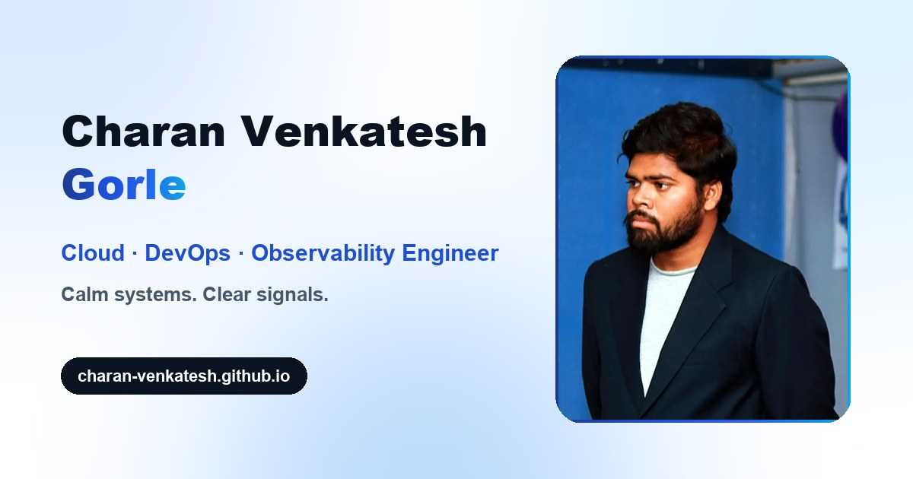

# Charan Venkatesh Gorle — Portfolio

**Cloud · DevOps · Observability engineer in Hyderabad, India.**
*Calm systems. Clear signals.*

🌐 **Live site:** https://charan-venkatesh.github.io/
👔 **Recruiters & founders — 30-second summary:** https://charan-venkatesh.github.io/hire/
💼 **LinkedIn:** https://www.linkedin.com/in/charan-venkatesh-gorle/
✉️ **Email:** charanvenkateshgorle@gmail.com · 📞 **Phone / WhatsApp:** +91 77807 60730

[](https://charan-venkatesh.github.io/)

## Highlights
- **3 Indian Navy systems deployed and in operational use:** Integrated Flight Safety Monitoring System (INS 324), Logistics File Status Management (INS DEGA) and WhatsApp service-desk routing (INS Circars). Also contributed to RFID-based asset tracking.
- **Enterprise AI-agent operations** at JoulestoWatts (Accenture client): OpenTelemetry tracing, log-based troubleshooting and incident handling.
- **Telemetry and BI:** predictive-maintenance analytics at Efftronics, plus Power BI and Grafana dashboards at DharviX.
- **Leadership:** Hult Prize Top 3 · Founder, Vedic Science & Culture Club · Lead Organiser, CONNECT 2K24 · GDSC core member.

## About this site
Built with Next.js, TypeScript and Tailwind CSS, exported as a static site and deployed to GitHub Pages by GitHub Actions on every push to `main`.

Features include:
- a 3D network-globe hero
- ⌘K search
- an interactive project filter (`/projects/?filter=navy`)
- a photo gallery with lightbox
- a WhatsApp and contact section with a QR code and vCard
- SEO metadata, a sitemap and structured data

```bash
npm install
npm run dev        # local development
npm run build      # static export to ./out
```

Site content lives in `src/data/portfolio.ts`.
